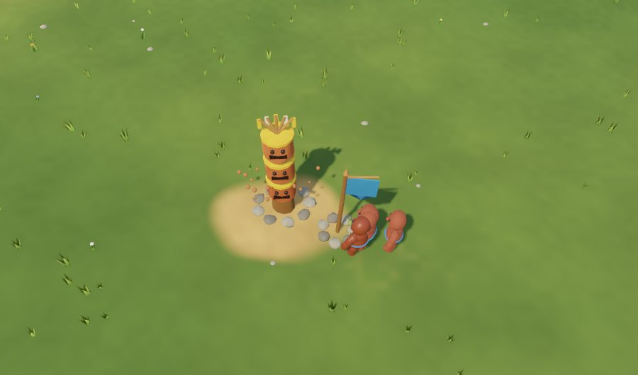
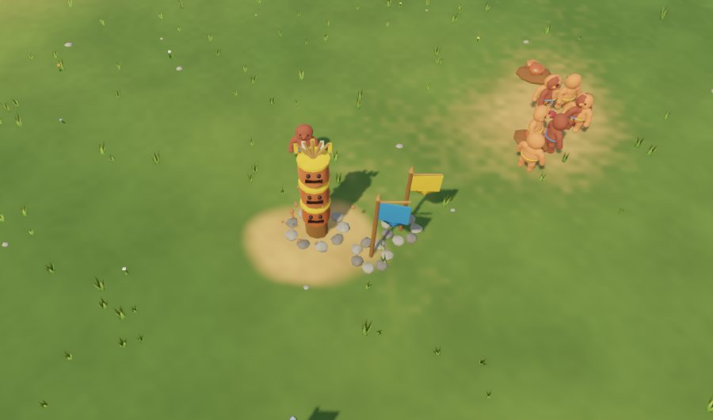

# Доминирование — этап 4

Концепция: [Праматерь и смысл партии](../Праматерь%20и%20смысл%20партии.md). Учтены замечания обзора [REVIEW_569d093](REVIEW_569d093.md): победа по таймеру и победа после первого паука заменены новым финалом.

## Как теперь заканчивается партия

Победа засчитывается не раньше 36 000 тиков (~1 ч при 1×). Пути к ней:

1. **Господство** — держать 2 из 3 источников особой глины целые сутки (6000 тиков). Если так сделают соседи, это поражение игрока.
2. **Ритуал Идола** — живой костёр и 30 единиц особой глины (этап 3).
3. **Великий ливень** — финал партии на 60 000 тике (~1 ч 40 мин при 1×). Когда он кончается, сравнивается счёт племён:
   - источник — 30 очков, тотем — 8, житель — 2, обожжённый — ещё 1;
   - если костёр пережил ливень и счёт не ниже соседского — победа;
   - иначе — «Великий ливень кончился: соседи сильнее (X против Y)» или «Великий ливень погасил костёр».

Раньше «Большой дождь» шёл на 15 000 тике и мог сразу дать победу, а «Одолеть паука» тоже было победой. Теперь паук — обычная задача. Предел партии в три часа остаётся.

## Война за землю

- **Осада** (`server/src/sim/siege.ts`). Стражники, стоящие в 5 единицах от чужого достроенного тотема, ломают его. Сломанный тотем снимает землю, и источник может перейти к соседям. Тотем под осадой кренится и пылит от ударов, в подсказке видна прочность. Строители хозяина его чинят.
- **ИИ-сосед** (`updateWar` в `settlementAI.ts`):
  - после 12 000 тиков, если у него хватает людей (не меньше 12 и не меньше 80% от игрока), идёт осаждать тотем игрока у источника;
  - переносит туда пост обороны и поднимает стражу до трети племени;
  - через 5000 тиков отступает и отдыхает 4000.
  - В дождь сырые стражники уходят под крышу, обожжённые — нет.
- **Оборона.** Стража бьёт врукопашную чужих стражников у своего поста (мирных прохожих не трогает). Достаточно поставить пост обороны рядом с тотемом. Стражник ест на ближайшем своём складе, а не только у костра: склад у границы кормит дальний пост. Игрок осаждает соседей так же — ставит пост у их тотема.
- **Советы Праматери:**
  - «Соседи осаждают тотем — поставь пост обороны рядом с ним»;
  - «Соседи держат 2 источника — через N ч. игры они победят. Осади их тотем постом обороны»;
  - «Великий ливень! Держите костёр живым».
- **HUD:** отсчёт господства («Мы держим 2 источника: победа через N с.» / «Соседи держат…: поражение через N с.»), объявление финала и счёт племён во время Великого ливня.

## Старые сохранения

- Если в сохранении ранний Большой дождь (на 15 000 тике), он остаётся прежней задачей «пережить с костром», а финал по счёту не срабатывает.
- В картах без источников нет победы господством.
- Флаги выполненных задач сохраняются.

## Проверка

- `npm run check:dominance` — 24 сценария:
  - осада ломает чужой тотем и не трогает свой, земля и источник уходят вместе с тотемом;
  - господство даёт победу, а у соседей — поражение, и не раньше минимума;
  - финал по счёту в обе стороны, старый ранний дождь ничего не решает;
  - ИИ объявляет войну, переносит пост и в живой симуляции ломает незащищённый тотем;
  - защищённый тотем выдерживает: 1241 тик схватки у поста, осада снята.
- Обновлены `check:world` (паук не победа, минимум, предел три часа) и HUD-тест. Все серверные проверки и Godot-тесты зелёные. Новый `godot/tests/game/test_dominance.gd` (HUD, крен и пыль тотема).
- Живая проверка на изолированном QA-сервере, новая случайная карта (`godot/tests/visual/capture_war.gd`):
  - игрок занял свой источник тотемами к тику ~5100;
  - сосед пришёл осаждать на тике 12 472 с 6 стражниками, тотем 147 → 118;
  - Праматерь предупредила;
  - игрок поставил пост рядом и поднял стражу, 5–8 его стражников вытеснили чужих, тотем устоял (134/150);
  - к 17 000 тику осада снята.

## Ограничения

- Баланс (очки финала, сила осады, время войны) подобран по одной карте. Нужна полная партия.
- Погасить чужой очаг нельзя.
- ИИ-сосед осаждает только тотемы у источников и не обороняет свои специально (его стража стоит у своего поста).
