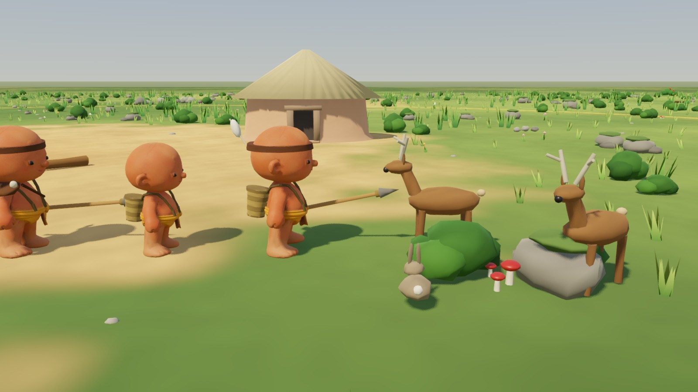
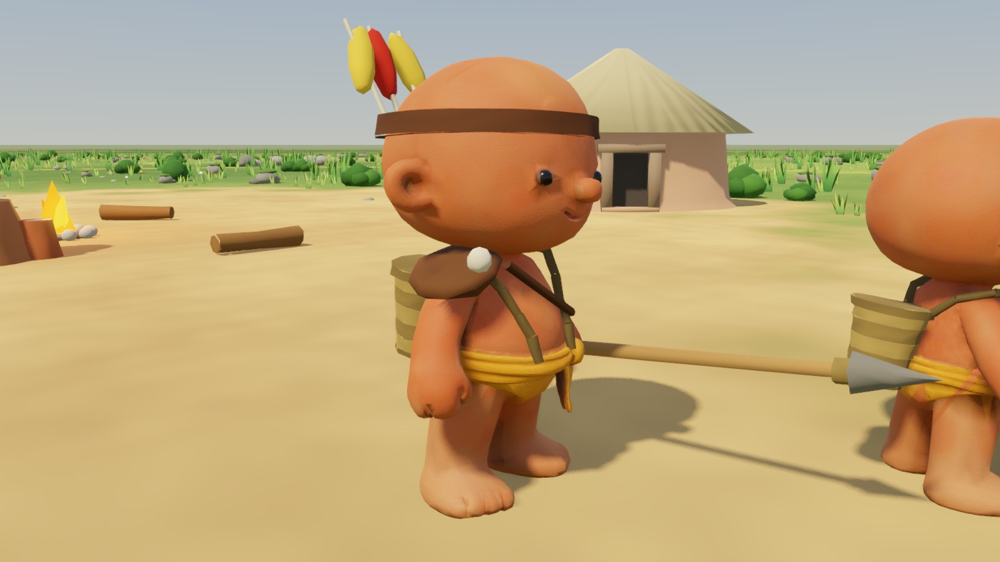

# Охотники и воины — 22.10.2026

По просьбе владельца: сильные жители племени, которых видно издалека.

## Дичь

`server/src/sim/hunting.ts`, список `Surface.animals` (не `enemies`: жители дичи не боятся, тревога её не замечает).

- **Олени:** 4 стада по 4 головы. Стада ставятся сначала в дикие углы без лагерей, потом на луга дальше 75 единиц от лагерей.
- **Зайцы:** 8, поодиночке.
- **Поведение:** пасутся у своего места (20 единиц) рывками. Если житель подходит ближе 10 единиц к оленю или ближе 5 к зайцу, зверь убегает на 60 тиков: олень со скоростью 1.25, заяц 1.45.
- **Возвращение:** убитый зверь возвращается к своему месту через 2400 тиков.
- **Сохранения:** в старых сохранениях дичь создаётся при первом тике.

## Охотники

- **Копья:** делает мастерская после топора, кирки и удочки. Стоимость — 3 дерева и 2 камня. Предел — 2 копья плюс 1 на каждые 10 жителей.
- **Работа «Охота»** (`job: "hunt"`) в панели «Работы»: одно копьё на охотника, строка показывает «копья: N». Праматерь посылает охотников, когда есть копья, дичь в пределах 170 единиц от лагеря и запасы не ломятся.
- **Охота:**
  - охотник бегает на 25% быстрее, выбирает ближайшего зверя (оленя охотнее);
  - копьё бросает с 7 единиц, раз в 36 тиков, с попаданием от 80% вплотную до 40% на пределе;
  - олень выдерживает 2 попадания, заяц 1;
  - добыча — 8 мяса с оленя, 3 с зайца; охотник несёт её на склад.
- **Клиент:** олени и зайцы на карте. Охотник на 15% крупнее, носит копьё и повязку с одним белым пером. Бросок — замах `work_chop` в сторону зверя.

## Воины

`server/src/sim/warriors.ts`.

- **Посвящение:** стражник у костра становится воином навсегда. Цена — 4 особой глины и копьё.
- **Предел:** 1 воин плюс 1 на каждые 8 жителей.
- **Сила воина:** +0.8 к силе (бьёт сильнее паука и чужую стражу), получает только 60% урона от паука, чужой стражи и в стычках, ходит на 10% быстрее.
- **Работа:** при сокращении стражи воинов в другие работы отправляют последними.
- **Кнопка в панели «Работы»:** «Посвятить воина (4 особой глины, копьё) · воинов: N»; когда посвятить нельзя, на кнопке написано почему.
- **Праматерь** посвящает сама, если идёт война, соседи осаждают тотем, идёт набег, враг у костра или накопилось 24+ особой глины. ИИ-сосед действует по тем же правилам.
- **Совет:** «Соседи воюют — посвяти стражника в воины» (когда Праматерь не решает).
- **Клиент:** воин на 15% крупнее, всегда с копьём, на голове кожаная повязка с тремя перьями (цвета племени и красное), на левом плече кожаный наплечник. В инспекторе — «· воин» / «· охотник».

## Проверки

- `npm run check:hunt` — стада на суше, бегство, копья, добыча и доставка мяса, возвращение зверя, сохранение, решения Праматери, посвящение и его отказы, предел воинов, стойкость к укусам паука.
- `godot/tests/world/test_hunting_view.gd` — дичь на карте, вид охотника и воина, строка «Охота», кнопка посвящения.
- Кадры: `screenshots/hunting/` (`tests/visual/capture_hunting.gd`).

