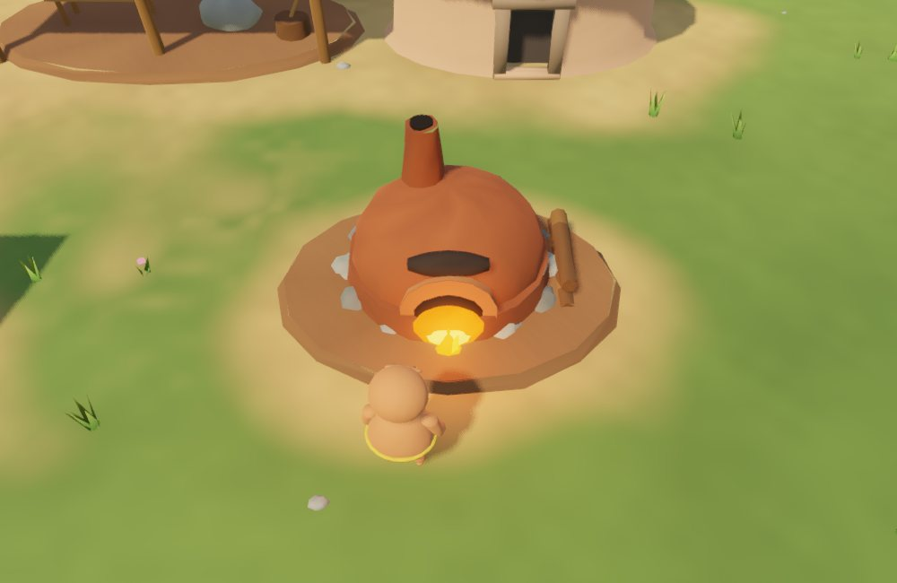
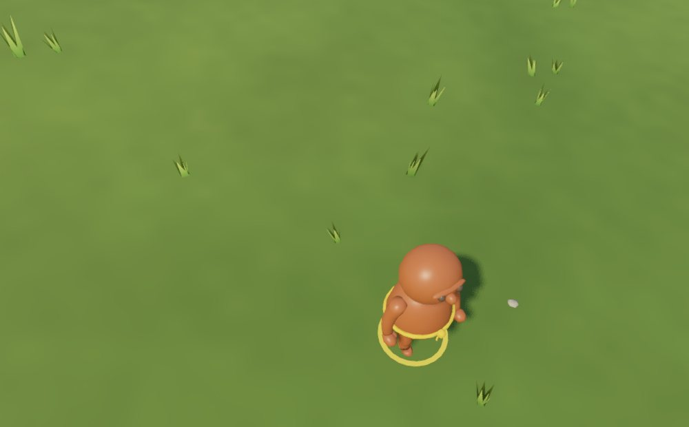

# Обжиг и дождь — этап 2

Концепция: [Праматерь и смысл партии](../Праматерь%20и%20смысл%20партии.md).

Дождь в симуляции уже был угрозой: под открытым небом жители намокают и глина размывается, стены оплывают и чинятся глиной, в озёрах жители растворяются (главная причина смертей в [плейтесте](PLAYTEST_2026_10_21.md)). Этап 2 даёт ответ на эту угрозу: печь обжига.

## Что сделано

**Печь обжига** — новая постройка (`kiln`): 10 глины и 6 камня, до 2 на племя, ставится как хижина. Логика в `server/src/sim/kiln.ts`:

- Свободная печь зовёт ближайшего сырого жителя без ноши (с еды или без дела), если у племени есть дрова (2 на обжиг + 4 в запасе), нет дождя, тревоги и паузы.
- Житель идёт к устью и стоит у печи. Обжиг (400 тиков) идёт, только пока он рядом: дождь уводит его под крышу, и прогресс ждёт. Дрова списываются при первом подходе.
- Если позванный погиб, попал в плен или не пришёл за 1500 тиков, печь освобождается.

**Обожжённый житель** (`Ant.fired`):

- не размокает под дождём (не намокает и не ищет укрытия);
- в воде растворяется в ~3 раза медленнее (`firedWaterFactor` 0,35) — больше шансов выбраться из озера или быть спасённым;
- сильнее в бою (+0,3 к силе).

Сырые ведут себя как раньше, поэтому старые сохранения не меняются.

**Праматерь и ИИ.**

- Праматерь ставит обжиг на паузу при нехватке еды или если стройка ждёт дерева, а его меньше 12.
- ИИ-сосед строит печь сам после 5000 тиков.
- Игрок может ставить обжиг на паузу и снимать её кнопкой; это переключает работы на «вручную».

**Советы и задачи.**

- Новые советы: «Сырых жителей N — поставь печь», «Печь остыла — нужны дрова». Перед дождём совет говорит, сколько сырых размокнет.
- Новые задачи: «Построить печь обжига» и «Обжечь 10 жителей».

**Godot-клиент:**

- модель печи: купол, устье, труба, поленница;
- пока идёт обжиг, в устье горят угли и пламя, светит тёплый свет;
- плитка «Печь обжига» (клавиша Q) в панели построек, предпросмотр и предел «n/2»;
- обожжённые жители заметно темнее, красноватые, с глянцем;
- в инспекторе строка «Глина: сырая / обожжён / идёт к печи»;
- в панели «Работы» строка «Обожжено N из M · печь горит» с кнопкой паузы.

**2D-клиент** рисует печь простым куполом, который горит во время обжига.

## Проверка

- `npm run check:kiln` — 23 сценария: условия вызова, обжиг только у печи, оплата дровами, дождь и вода для сырых и обожжённых, освобождение печи, сохранение, пауза Праматери. Плюс 14 000 тиков живой симуляции: печь игрока обожгла 21 жителя, ИИ-сосед построил свою печь и обжёг 10.
- Паритет размещения пересобран с печами: 1200 запросов, 0 расхождений (`test_build_rules`).
- `godot/tests/game/test_kiln.gd` — 13 проверок клиента.
- Все серверные проверки и Godot-тесты зелёные, включая интеграционные `test_build_tools` и `test_qa_network_client`.
- Живая проверка на изолированном QA-сервере с миром поздней партии (`godot/tests/visual/capture_kiln.gd`): печь поставлена настоящим инструментом стройки, строители её достроили, жители пришли на обжиг, в устье горит огонь, 4 обожжённых за ~3 минуты при 5×.

## Ограничения

- Обжиг стен пока не сделан: стены по-прежнему оплывают под дождём и чинятся глиной. Это следующий шаг этапа.
- Нет отдельного вида «мокрого» сырого жителя: размокание видно только по смертям и по тому, как они прячутся.
