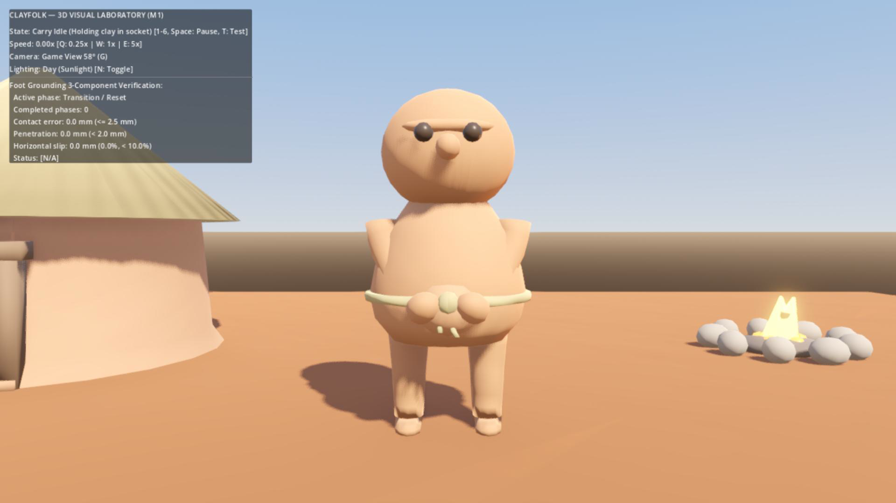

# Проверка defc128 — ноги исправлены, переноска требует доработки

Дата: 19.10.2026. Проверенный commit: `defc128b5e923d7a2acfef5f0592047f83bf1499`, ветка `codex/godot-3d-migration`. Перед аудитом рабочее дерево чистое, HEAD совпадал с origin.

## Решение

Регрессия весов ног из ba300ea устранена и независимо подтверждена в сохранённом Blender-файле и импортированном Godot-меше. Повторно переделывать ноги не требуется. Это техническая приёмка исправления ног в лаборатории, а не всего визуального M1 или движения живого поселения.

M1 целиком пока не принят: свежий GPU-рендер переноски показывает погружение рук и груза в корпус. Художественное одобрение владельца также ещё не получено. Независимую сетевую часть M2 можно продолжать согласно §10 основного ТЗ, не тиражируя неподтверждённый внешний вид.

## Воспроизведённые проверки

Godot `4.7.2.stable.official.ed1daf0bf`, Blender `4.2.3 LTS`; GPU-кадр: Forward+ / Vulkan, RTX 4070. Сервер пользовательской партии не запускался и не получал команд.

| Проверка | Результат этого аудита |
|---|---|
| `py -B scripts/godot/test_qa_server.py` | 10/10, exit 0; сообщения ERROR внутри отрицательных тестов ожидаемы |
| `godot_console --headless --path godot --editor --quit` | Импорт/загрузка, exit 0 |
| `godot_console --headless --path godot scenes/lab/resident_lab.tscn --test-grounding` | Все 8 стадий, exit 0 |
| `godot_console --headless --path godot scenes/lab/resident_lab.tscn --test-rigor` | Все 8 стадий, exit 0 |
| Независимый аудит сохранённого `resident.blend` | 1326 вершин, 0 без весов; обе UpperLeg по 60 записей, LowerLeg по 48, Foot по 24 |
| Независимый аудит импортированного GLB | Все 24 нижние вершины: 12 Foot.L и 12 Foot.R; neutral_bone отсутствует в их влияниях; положения меняются в walk и carry_walk |
| Независимая выборка 301 фазы пяти клипов | В опорных окнах ошибка нижних точек стоп до 0,770 мм; idle/carry_idle/work_gather стоят на уровне пола |

Последние три проверки выполнены внешними read-only скриптами предыдущих аудитов: `audit_weights.py`, `audit_actual_soles.gd`, `audit_runtime.gd` в `%LOCALAPPDATA%/Clayfolk/reviews/`. Они не регенерируют ассеты и не сохраняют Blender-файл. Матрица и rigor в репозитории воспроизводятся командами выше.

В матрице walk/carry_walk на 0,25×/1×/5× контакт до 0,77 мм; скольжение в этом запуске до 6,58% длины стопы на 5×, до 2,80% на 1×. Пиковая высота выборки маховой стопы 91–92 мм. Это максимум среди точек стопы, не гарантия такого просвета под всей подошвой. Результат зависит от дискретизации кадров; обещание «скольжение всегда <3%» неверно для 5×.

Отрицательные случаи обнаружены: отрыв +0,5 м, проникновение −0,05 м, рассинхронизация 2,2× и замороженные вершины (No-Lift 0,0 мм, Slip 80%). Последний тест подменяет расчёт выборки неподвижными координатами, а не создаёт отдельный испорченный GLB; структурная проверка импорта дополнительно отвергает neutral_bone у подошв.

Конкурентный stale-lock тест теперь действительно использует потоки и barrier. Lifecycle-тест запускает родителя и дочерний Python-процесс с TCP-портом; это содержательная проверка дерева, но ещё не проверка жизненного цикла настоящего сервера Node/tsx и загрузки настоящего WorldSnapshot. Эти интеграционные сценарии остаются первым шагом M2.

## Что осталось в изображении

На новом GPU-кадре `carry_idle` руки в значительной части скрыты корпусом, груз спереди практически не читается. Аналогичное пересечение видно в записанном `tour_07_carry_walk_slowmo.png`. При обычной ходьбе сверху плеч остаются плоские выступающие торцы: утверждение о полностью цельном органическом контуре преждевременно.

Кадр получен текущим Godot через Movie Maker, взят после 10 кадров ожидания позы. Источник и лог: `%LOCALAPPDATA%/Clayfolk/reviews/m1-defc128-2026-10-19/`. Проверка близости костей кистей к сокету (~0,157 м) и наличие BoneAttachment не доказывают видимость груза или отсутствие пересечения реальной геометрии с животом. Нужна проверка контура тела, груза и деформированных рук в нескольких ракурсах.

Грунт и глина стали спокойнее, прежняя сильная полосатость уменьшена. Это не окончательная художественная приёмка. Записанный тур исполнителя доступен в `godot/recordings/resident_lab_tour.mp4`; в этом аудите просмотрены отдельные кадры, выполнен свежий GPU-рендер и измерены фазы, полный ролик в реальном времени не оценивался.

`git diff c52f265 -- server shared client` пуст: серверная симуляция, shared и прежний браузерный клиент сохранены. M2 ещё не реализован; результаты лаборатории нельзя распространять на интерполяцию реальных жителей, стены, берег и ускорения 20×/50×.

Продолжение: [переноска и сетевой M2](<../Antigravity — переноска и сетевой M2.md>).
