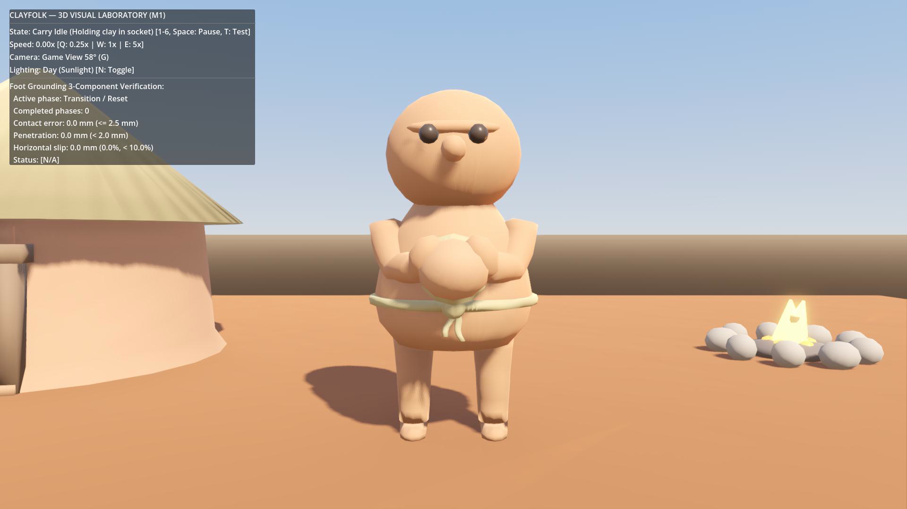

# Приёмка fd30aea: сетевой каркас работает, M2 не принят

Дата: 20.10.2026. Проверены `150caf9`, `2d187f2`, HEAD `fd30aea` в ветке `codex/godot-3d-migration`; до аудита дерево чистое, после fetch HEAD совпадает с origin. Сервер/shared/браузерный клиент не отличаются от `c52f265`.

## Что подтверждено

- Переноска стала читаемой: свежий GPU-кадр текущего GLB показывает груз перед грудью и кисти по бокам. Исходный дефект defc128 больше не воспроизводится в проверенном фронте. Это не художественное одобрение владельца и не измерение зазора по всей поверхности груза: текущий clearance-тест измеряет сокет относительно фиксированной плоскости торса.
- В сохранённом `resident.blend` 1328 вершин, 0 без весов. Независимый CPU-skinning импорта снова даёт опорную ошибку до 0,770 мм в пяти клипах.
- Headless import — exit 0; grounding 8/8 и rigor 9/9 — exit 0. Максимум скольжения в этом лабораторном запуске 6,73% длины стопы на 5×, допуск 10%.
- `py -B scripts/godot/test_qa_server.py`: 12/12 OK, включая чужой token и настоящий Node/tsx lifecycle с загрузкой fixture.
- `py -B scripts/godot/test_m2_network_integration.py`: оба запуска проходят, exit 0. Но скрипт подключается к серверу **Python-сокетом**, не запускает Godot и не проверяет его decoder/registry/интерполяцию.
- Три Godot runner-а выводят 4/4 + 4/4 + 5/5 PASS, exit 0. При выходе есть ошибки освобождения RID/ObjectDB; это утечки тестового окружения, не доказательство утечки игрового клиента. Часть проверок не охватывает заявленные свойства, см. ниже.
- Дополнительно запущены настоящий WSClient и EntityRegistry на отдельном Node/tsx QA-сервере: за 3 секунды 25 snapshots и 18 актёров; headless Godot exit 0. Подключение к настоящему серверу работает.



## Блокирующие ошибки M2

### 1. [P1] Неверный интервал интерполяции возвращает рывки

`entity_registry.gd:37` вычисляет `0.1 / speed`, хотя `server/src/loop.ts:54` ограничивает рассылку реальными 100 мс независимо от ускорения симуляции. Вычисленный в registry реальный `dt` вообще не используется. Буфера временных snapshots нет: NetworkResident каждый раз делает lerp от текущего положения к последней цели.

В настоящем QA-прогоне на 5× после стартовой очереди интервалы пакетов 85/124/124/124/134 мс, а `interp_duration` постоянно 20 мс. Независимый детерминированный пример: смещение 0,24 м за 100 мс, шесть кадров по 1/60 с:

```text
duration=0.02
движение по кадрам, мм: 199.997, 40.001, 0, 0, 0, 0
состояния: WALK, WALK, IDLE, IDLE, IDLE, IDLE
```

Это рывок и ожидание следующего пакета, не плавное ускоренное движение. На 20×/50× проблема усиливается. Тест `test_speed_scales_0_1_5_20_50` сам передаёт искусственно уменьшенный интервал и поэтому подтверждает ошибочное предположение.

Дополнительно: `network_resident.gd:225` ограничивает частоту шага 8×; при скорости выше 3,84 м/с формула `ground_speed / 0.48` уже не выполняется. Порог 8 м считает обычное большое смещение телепортом без учёта tick/скорости/контекста. Требуется явная политика высоких скоростей, а не обещание полной синхронизации.

### 2. [P1] Модель идёт спиной вперёд

У GLB передняя сторона — локальная +Z, что подтверждают геометрия лица/сокет и собственный `check_cargo_clearance`. `network_resident.gd:198` поворачивает стандартную −Z к направлению движения. После установления движения по +X замер `(global_basis * Vector3.BACK).dot(Vector3.RIGHT) = -1.0`: лицо направлено ровно назад.

### 3. [P1] Пауза/разрыв меняют позу вместо фиксации

`_update_movement_and_animation` переключает walk в idle, затем устанавливает `speed_scale = 0`. Воспроизведение: walk, фаза 0,23 → `on_network_stalled()` → обновление скелета: клип стал idle, положение кости Foot.R изменилось на **65,118 мм** при неподвижном корне. Пауза использует ту же ветку. Существующий тест проверяет координаты корня и speed_scale, но не сохранение позы.

В GPU-туре стадия «pause» (`world_observer.gd:182–189`) только один раз выставляет локальный speed=0 и stall; следующий входящий snapshot сбрасывает это. Сервер не ставится на паузу. Ролик не подтверждает реальную серверную паузу.

### 4. [P1] Несовместимый протокол принимается; тест декодера его не вызывает

`ws_client.gd:128` использует AND между двумя несовпадениями. На реальном локальном WebSocket-сервере оба пакета `(snapshotVersion=21, protocolVersion=999)` и `(999,21)` дали `decoded=1, errors=0`. Требуется проверять отдельно оба обязательных поля и их типы. Сейчас даже почти пустой dict с одной подходящей версией может дойти до registry и удалить жителей через fallback `ants=[]`.

`test_packet_decoder.gd` проверяет `JSON.parse_string` и заново написанное условие, не production `_process_packet`. Signal-capture `received` создан, но не проверяется. Ветка несовместимости дополнительно затирает ERROR обычным `disconnect_from_server`, которое ставит DISCONNECTED и сообщение «by user». Статус CONNECTED(v21) отображается ещё до проверки первого snapshot.

### 5. [P1] Отображение карты не соответствует серверному миру

`WorldView._ready` без snapshots рисует две круглые воды, два костра и четыре хижины по константам. `_on_snapshot_received` обновляет только жителей и HUD; buildings/resources/enemies/fish не попадают ни в registry, ни в базовое представление. Нет проверки сегментов движения на здания/ограду/берег. Например, «северное озеро» клиента — круг радиусом 32 с центром (260,118), тогда как эталон `shared/surfaceTerrain.ts` имеет другой ступенчатый полигон до y=176. Круг содержит заведомую серверную сушу и пропускает реальную воду.

Для M2 не требуется финальный арт M4. Требуются минимальные честные формы/ID/счётчики препятствий и берег по shared-геометрии. Иначе нельзя проверять, проходят ли люди сквозь действительные объекты.

## QA и границы доказательств

`request_stop` не является мягким сохранением партии: watcher вызывает `kill_process_tree`, на Windows это `taskkill /T /F`, а полученный код принудительно превращается в 0 при `stop_requested`. В отдельном прогоне 3 с на 5× сохранённый tick остался исходным 12345. Это подтверждает очистку порта/lock, но не финальное сохранение прогресса. Проверить graceful-stop с подтверждённым актуальным snapshot; аварийный kill оставить fallback с честным статусом. Корневые сейвы при этом не использовать.

Нет end-to-end сравнения Godot registry с серверными ID/позициями, реальной паузы/ускорений/смены мира и теста безопасной траектории. `test_clean_reconnect_zero_duplicates` вызывает `clear_all` напрямую; это не сетевое переподключение. Работа по этим пунктам нужна до M3, без возврата к генерации ног или массовому арту.

## Воспроизведение

Основные команды приведены выше. Три Godot runner-а: `tests/net/test_packet_decoder.gd`, `tests/world/test_entity_registry.gd`, `tests/world/test_network_interpolation.gd`, запускаются через `godot_console --headless --path godot -s <путь>`.

Дополнительные read-only аудиты сохранены в `%LOCALAPPDATA%/Clayfolk/reviews/m2-fd30aea-2026-10-20/`: `audit_runtime.gd` (кадровые смещения, направление +Z, скачок позы), `audit_ws.py` + `audit_ws.gd` (реальные несовместимые WS-пакеты), `audit_live.py` + `audit_live.gd` (настоящий QA-сервер на свободном порту, Godot WSClient+registry). GPU-кадр получен через Movie Maker, после 10 кадров установления позы. Полный записанный ролик в реальном времени в этом аудите не оценивался.

Состояние отдельного аудита: `tmp/qa/codex-review-d322eea5`, fixture вне state-dir. Собственный сервер остановлен, порт освобождён. Текущая пользовательская партия не использовалась для команд/сброса/ускорения. Тестовый файл `request_stop` — отдельная QA-операция, не подтверждение сохранности финального прогресса.

Следующий этап: [точечное исправление M2](<../Antigravity — исправить M2 после fd30aea.md>).
