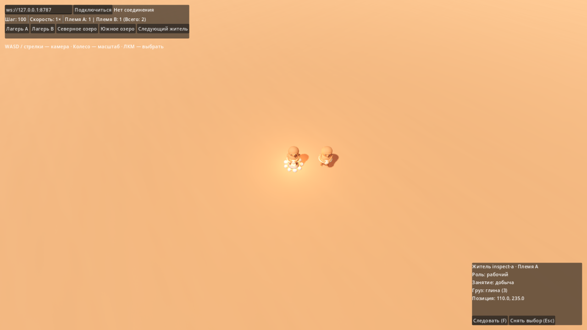

# M3: камера и выбор жителя

20.10.2026. Исполнитель — Codex по поручению владельца. Реализация **`7eb0a8a`**, база `0666271`, ветка `codex/godot-3d-migration`.

Первый небольшой шаг управления: WASD/стрелки, плавный зум колесом, границы карты, переход к фактическим лагерям; выбор жителя лучом, подсветка, роль/занятие/груз, следование и снятие выбора. Игровые команды и строительство в этот шаг не входят.

План файлов: `world_view.gd` — камера и лагеря из snapshot; `network_resident.gd` — отдельная область выбора и кольцо; `world_observer.gd` — ввод, стабильный выбранный ID и панель; `tests/game/test_observer_controls.gd` — интеграция пользовательского ввода с production-сценой. Затем обновить SETUP, FEATURE_PARITY и status/acceptance.

Риски: клики по HUD не должны выбирать объект под ним; набор адреса не двигает камеру; удаление/переподключение не оставляет чужие сведения; коллайдер выбора не участвует в движении. Существующие туры и лаборатория сохраняются, tracked записи не перезаписываются. QA — только собственные порты и файлы состояния.

## Готовый результат

- F5 и обычный запуск проекта открывают клиент. Без явного `--connect`/`--qa-port` он ожидает нажатия «Подключиться»; лаборатория запускается отдельной сценой.
- WASD/стрелки перемещают фокус в пределах 0..480 по X/Z. Угол фиксирован 52°, масштаб колесом плавный, дистанция 4..80. Большой delta не вызывает overshoot зума/следования. Рамка видимой земли не зажимается целиком внутри карты: ограничена именно точка фокуса.
- «Лагерь A/B» использует реальные координаты surface.entrances, а не только стартовые константы.
- Raycast попадает в query-only Area3D жителя; выделение отмечено кольцом. Эти области не толкают жителей и не заменяют серверную навигацию.
- Выбор хранится по ID. Панель показывает племя, роль, занятие, отображаемый груз и координаты; она обновляется и при смене порядка snapshots. Удаление выбранного жителя и переподключение очищают выбор.
- F/кнопка переключают следование, ручное движение камеры прекращает его без потери выбора. Esc снимает выбор. HUD поглощает клики/колесо, набор адреса не двигает камеру.

Игровые команды, зоны, выбор зданий/ресурсов, миникарта, HUD складов и строительство в этот шаг не входят. Для прочих мировых объектов ещё не реализована общая система коллайдеров выбора/окклюзии; raycast этого шага проверяет слой жителей. Модели и симуляция не менялись.

## Проверки

```powershell
godot_console --headless --path godot --editor --import
godot_console --headless --path godot --quit-after 3
godot_console --headless --path godot --script tests/game/test_observer_controls.gd
godot_console --headless --path godot --script tests/world/test_network_interpolation.gd
godot_console --headless --path godot --script tests/world/test_surface_navigation.gd
godot_console --headless --path godot --script tests/net/test_packet_decoder.gd
godot_console --headless --path godot --script tests/world/test_entity_registry.gd
godot_console --headless --path godot --script tests/world/test_surface_terrain.gd
py -B scripts/godot/test_qa_server.py
py -B scripts/godot/test_m2_network_integration.py
npm.cmd run check
```

Все завершены exit0. Прошли 38 существующих unit-сценариев и **16 новых проверок пользовательского ввода**. Они подают события viewport/клавиатуры в настоящую сцену: лучи обоих племён, клик/подсветка, защита HUD, набор адреса, зум/границы, стабильный ID, follow, обновление инспектора и очистка. Headless-viewport использует локальные координаты при push_input, чтобы тест учитывал масштаб окна.

QA: 12/12. Расширенный integration запускает три настоящих Godot-клиента: прежние проверки fresh/fixture и новую production-сцену observer. На fixture подтвердились выбранные ant-1 (племя A, груз 1) и ant-9 (племя B, груз 2), видимая подсветка и сведения в панели. Затем сервер перезапущен из сохранения: saved/resumed tick12371. QA-порты 8788/8789 проверены свободными до запуска и после остановки; только свои tmp/qa/integration_fresh и integration_fixture с четырьмя явно заданными файлами состояния. Пользовательская партия не затрагивалась.

GPU-прогон той же проверки ввода: Godot 4.7.2, Vulkan Forward+, RTX 4070, exit0. Кадр ниже сделан на детерминированном fixture двух жителей; реальный Node→Godot проверен отдельно headless integration. Кадр визуально проверен: видны кольцо выбора, информация и кнопки, панель не обрезана. Это не FPS-тест и не художественное одобрение моделей. Для повторения GPU-проверки можно указать абсолютный путь PNG в переменной CLAYFOLK_UI_CAPTURE и запустить tests/game/test_observer_controls.gd без --headless; запускать скрыто через Start-Process -WindowStyle Hidden.


