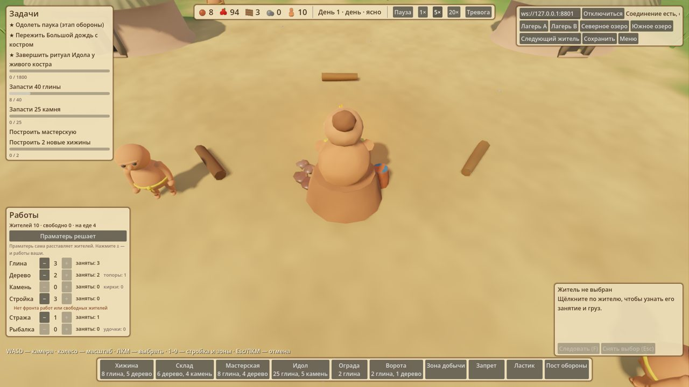
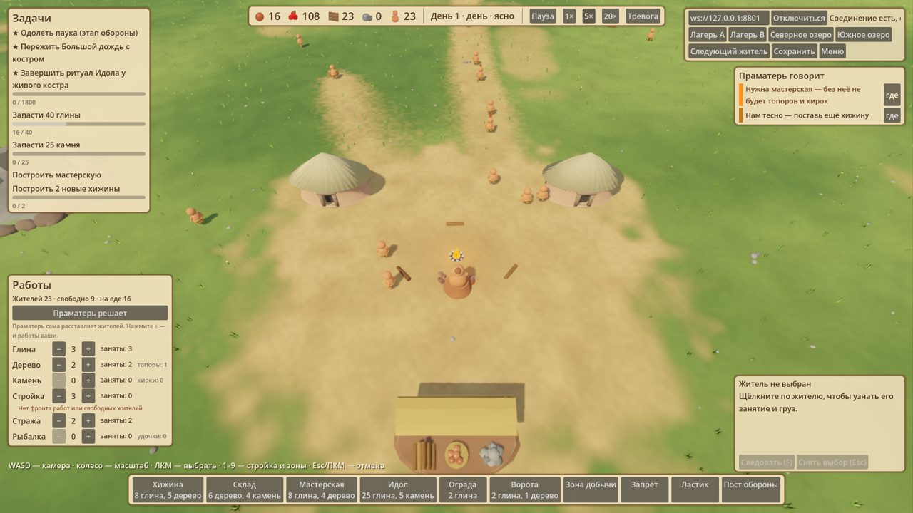

# Праматерь ведёт племя игрока — этап 1

Концепция: [Праматерь и смысл партии](../Праматерь%20и%20смысл%20партии.md).

## Что сделано

- **ИИ Праматери для игрока.** `server/src/sim/settlementAI.ts`: логика племени (приоритеты работ, запас глины перед лепкой, тревога) вынесена в `runTribeLogic` и работает для игрока, пока `colony.autoManage` («Праматерь решает») включён. Стройка и расширение остаются игроку. Тревогу, поднятую Праматерью, она снимает сама; ручную тревогу не трогает.
- **Режимы.** Новая партия начинается с «Праматерь решает». Ручное `setPriorities` или `setGrowth` переключает на «вручную». Команда `setAutoManage {colony, value}` переключает режим явно. Старые сохранения без флага грузятся в ручном режиме.
- **Советы.** `server/src/sim/advisor.ts` раз в 100 тиков собирает `colony.advice`: враг у лагеря, чудище у берега, голод/мало еды, гаснущий костёр, «нам тесно — нужна хижина», «глины нет», «нужна мастерская», «на стройку не хватает …», «тучи собираются». Совет живёт, пока есть причина; после исчезновения тот же совет молчит 1200 тиков (кроме опасных). Не больше 4, опасные первыми.
- **Godot.** Панель «Работы» с кнопкой «Праматерь решает / Вручную»; лента «Праматерь говорит» справа с кнопкой «где» (камера к месту), новый совет вспыхивает. У каждого костра сидит Праматерь в цвете своего племени: мнёт глину, а при появлении нового жителя наклоняется, ком растёт и разлетается облачко глины. Погибшая Праматерь исчезает. Подсказка при наведении.

## Проверка

- `npm run check:mother` — 20 сценариев (авто/ручной режим, тревога, советы и кулдаун, сохранения, 6000 тиков headless).
- Остальные серверные проверки зелёные; бенчи ручного управления явно выставляют ручной режим.
- `godot/tests/game/test_mother.gd` — 18 проверок; остальные Godot-тесты без регрессий.
- Живая проверка на изолированном QA-сервере: `godot/tests/visual/capture_mother.gd` — 14 лепок за 150 с при 5×, 4 разных набора приоритетов от Праматери, советы «нам тесно» и «нужна мастерская», переключение режима через панель туда и обратно.

## Ограничения

- Логика Праматери пока та же простая таблица, что у ИИ-соседа; характеры и обучение — позже.
- Лимит 8 хижин остаётся: совет честно говорит «лагерь полон». Улучшение жилья — этап территории.
- Мультиплеер: авто-режим относится к колонии игрока (`playerColonyIndex`).
