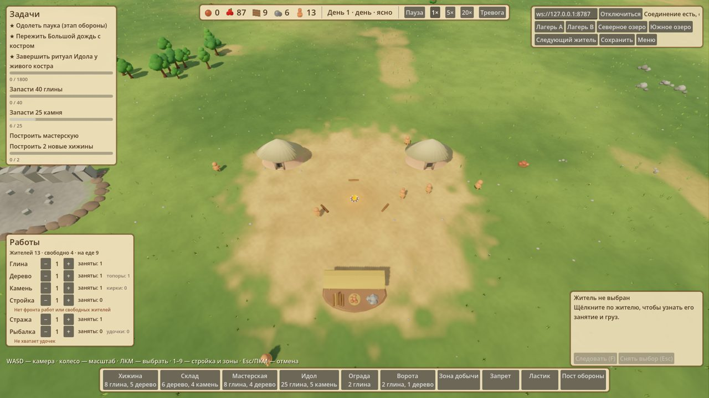
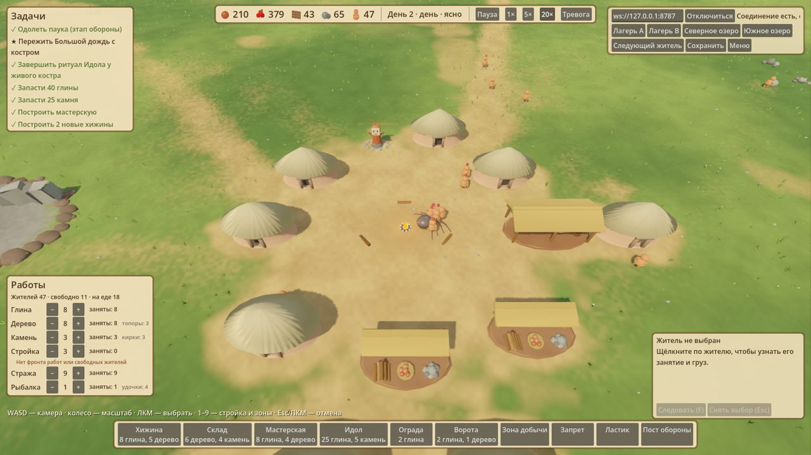
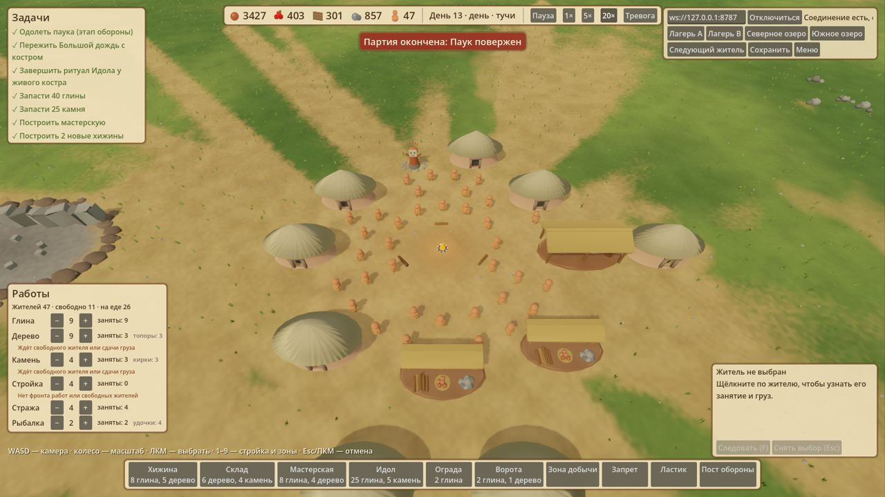

# Полная партия в Godot-клиенте — 21.10.2026

Автоматический плейтест: `godot/tests/playtest/full_match.gd` играет за племя A через те же инструменты, что у человека (стройка, приоритеты работ, пост обороны, тревога), против изолированного QA-сервера (`scripts/godot/qa_server.py --reset`, отдельный state-dir). Пользовательские сохранения не затрагивались.

```
godot --path godot --script res://tests/playtest/full_match.gd -- --server-port 8799 --out <dir> --speed 20
```

## Партия

- Случайный мир, seed 9716477: 2 озера, 4 горы, лагеря в противоположных углах.
- Финал «Паук повержен» на тике 72000 (порог `matchMinTicks`), 13 игровых дней, 1107 реальных секунд при запрошенной скорости 20×.
- Родилось 118 жителей, погибло 40, отбито 10 набегов, спасено 5. Племя B (ИИ) построило 46 построек, население 47.
- Ни одного падения и ни одной ошибки скрипта за 18 минут.





## Что нашлось

1. **Темп сломан.** Ритуал идола завершён к тику ~6500, все задачи, кроме «12 сегментов стены», выполнены в первые ~10% партии. Дальше ~65 000 тиков ожидания порога минимального времени: решать нечего.
2. **Нет расхода ресурсов.** К концу 3427 глины, 857 камня, 301 дерева. Население упирается в 47 из-за лимита 8 хижин уже к тику ~6500.
3. **Набеги не страшные.** Каждый отбит за 100–1200 тиков. Стены так и не понадобились.
4. **Настоящая угроза — озёра.** 20+ смертей «Озеро поглотило жителя» от озёрных чудищ: игрок этого не видит и не может предотвратить.
5. **Еда несколько раз падала до 0.**
6. **Скорость.** Шаг сервера 14–18 мс на случайной карте с ~94 жителями, поэтому реально выходит около 6×. Кнопки 20×/50× этого не дают.
7. **Клиент в норме.** На поздней партии (94 жителя) при 1× кадр в среднем 5 мс, p99 ≈ 30 мс. Плохие цифры в логе плейтеста получились из-за самого харнесса и загруженного сервером CPU.

## Исправления по приоритету

1. Финал от событий, а не от таймера: финальный паук или «Большой дождь» приходят, когда выполнены задачи этапа, а `matchMinTicks` остаётся только нижней границей.
2. Удорожить и растянуть идола: ритуал в несколько этапов и подношения.
3. Расход ресурсов: ремонт и укрепление стен, улучшение хижин вместо жёсткого лимита 8, глина на новых жителей.
4. Нарастающие набеги, которые проверяют стены и ворота, со временем перестают проходить без ограды.
5. Озёрные чудища: предупреждение на берегу, видимая зона опасности, запрет рыбалки в опасных местах.
6. Еда: тревога в HUD при запасе меньше чем на день, приоритет еды поднимается автоматически.
7. Профилировать шаг сервера на случайных картах (навигация, озёра), чтобы 20× стали реальными.
8. Онбординг: подсказки «что делать дальше» и всплывающие события (набег, смерть, рождение).
9. Читаемость боя: кто дерётся, полоски здоровья, раненые.
