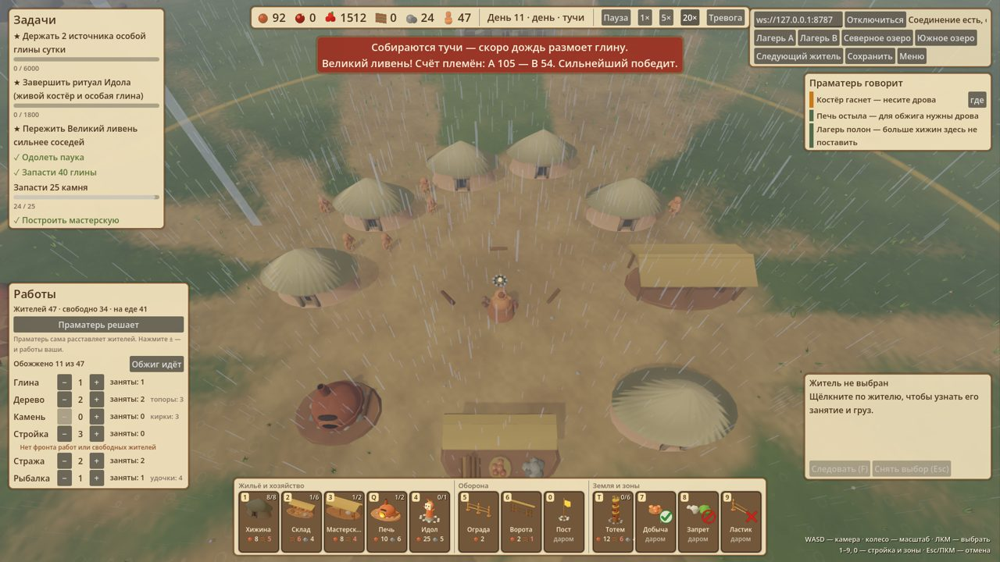
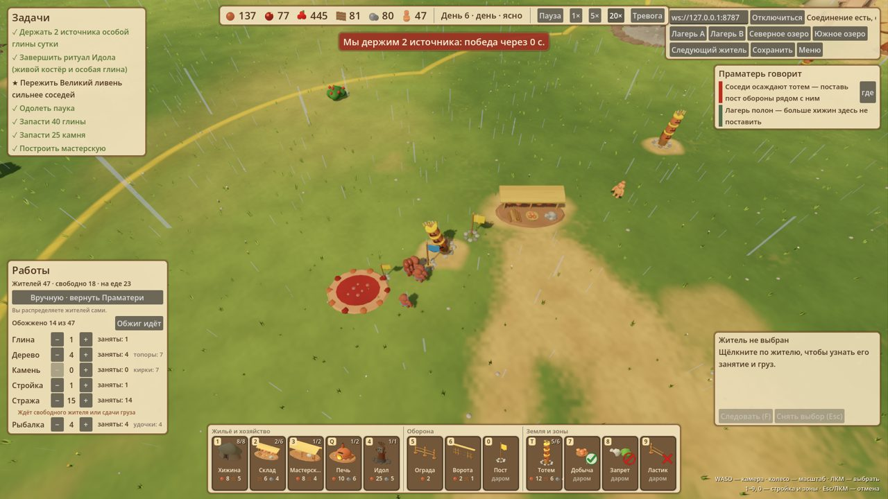

# Полная партия после этапов 1–4 — 22.10.2026

Автоплейтест `godot/tests/playtest/full_match.gd` через Godot-клиент против изолированного QA-сервера (`--reset`, новая случайная карта, скорость 20×). Сохранения владельца не затрагивались.

Автоигрок играет как разумный человек при включённой Праматери:
- строит мастерскую, хижины, печь, склады и идола, когда пошла особая глина;
- ведёт тотемы к своему источнику, потом ко второму;
- при осаде ставит пост у тотема и поднимает стражу, затем возвращает работы Праматери;
- если соседи держат два источника, осаждает их тотем.

Прогонов два: первый на старом балансе экономики, второй после правки.

## Прогон 1 — поражение «Великий ливень погасил костёр племени»

- 64 131 тик за 586 с реального времени (~110 тиков/с — почти вдвое быстрее, чем в первом плейтесте).
- **Голод на дерево.** Всю партию у племени игрока 0–6 дерева при 1500 еды и 92 глине.
  - Праматерь держала на дереве 2 жителей из 47: таблица работ не зависела от размера племени.
  - Топоров было не больше 3 (жёсткий предел).
  - Костёр и печь доели дрова, к ~27 000 тику костёр погас навсегда.
- Без дерева нет тотемов, поэтому нет источников, особой глины и идола. Соседи по той же логике тоже не взяли ни одного источника. Борьба за землю не началась.
- **Финал.** Великий ливень почти вымел сырых жителей (у соседей 39 → 2, у игрока 47 → 21–29, выжили в основном обожжённые). По счёту игрок был сильнее (105 против 54), но костёр погас — поражение.

**Исправлено перед прогоном 2:**
- Праматерь распределяет работы пропорционально племени и нуждам:
  - на дерево около 1/5 племени, больше, когда слабеет костёр или стройке нужно дерево;
  - глина и камень — пока их мало;
  - стройка — по числу площадок;
  - лишние уходят с еды, когда её избыток;
  - обжиг на паузе, пока костёр слаб.
- Предел топоров и кирок: 3 плюс 1 на каждые 10 жителей.
- Запас дров, которые печь не трогает: 4 → 8.
- Проверка без графики: у соседа дерево 40–77, костёр всегда горит, 6 тотемов и 2 источника к 21 000 тику.

## Прогон 2 — победа «Племя завладело источниками особой глины»

36 000 тиков за 322 с (~112 тиков/с), карта seed 911028219.

| тик | что произошло |
|---|---|
| 450–2500 | мастерская, хижина, печь |
| 3100–5000 | цепочка из 3 тотемов к своему источнику |
| 6300 | племя A заняло источник |
| 6500 | идол |
| 9700 | соседи заняли свой источник |
| 10 800 | склад у границы |
| 15 000–17 000 | ещё 2 тотема ко второму источнику |
| ~18 000 | ритуал Идола завершён (1800/1800) — победа уже возможна, но ждёт минимума |
| 21 500 | племя A держит 2 источника — отсчёт господства |
| 27 500 | господство выполнено — снова ждём минимума |
| 29 400 | соседи идут осаждать тотем; пост поставлен поздно, тотем разрушен (30 043) |
| 34 100 | вторая осада; у тотема у озера монстры утащили ~9 жителей за 1300 тиков |
| 36 000 | победа господством на минимальном сроке; население 47 → 17 за последние 2000 тиков |

## Что нашлось

1. **Темп снова ломается, только позже.** Ритуал готов к ~18 000, господство к ~27 500, а победа засчитывается не раньше 36 000. Это опять ожидание, хотя уже не 65 000 тиков, а около 18 000. До финала-ливня дело не дошло.
2. **Сосед вступает в войну слишком поздно.** ИИ воюет, только когда у него не меньше 80% населения игрока. Игрок упёрся в 47, сосед держался на 31–39, поэтому первая осада случилась лишь на 29 400. Против господства игрока сосед ничего не делал.
3. **Бои у источников идут у воды**, а там озёрные монстры. Во второй осаде они утащили около 9 стражников, население рухнуло. Источник ставился всего в 8 единицах от берега.
4. **Предел населения 47 с 12 000 тика** (8 хижин) и копящиеся ресурсы: к концу 139 глины, 90 дерева, 80 камня, 117 особой глины без применения. Совет «Лагерь полон» висит полпартии.
5. **Автоигрок реагировал на осаду поздно** (раз в 300 тиков), и тотем пал. Человеку Праматерь сразу показывает «Соседи осаждают тотем»; за ~1 минуту при 1× отреагировать можно.
6. **Производительность клиента в норме:** средний кадр 7,9 мс, p99 44 мс. Отдельные долгие кадры в начале (до 0,8 с) — это подготовка и снимки автоигрока. Падений и ошибок скриптов нет.

## Что предлагается исправить

1. **Темп победы.** Победа засчитывается сразу, как только условие выполнено, но условия тяжелее, а минимальный срок остаётся страховкой:
   - господство — 2 источника 2 суток или все 3 источника сутки;
   - ритуал — 60 особой глины;
   - так финал-ливень становится реальной развязкой.
2. **Сосед против лидера.** Если игрок держит 2 источника, сосед идёт войной независимо от численности. Отказаться от правила 80% в пользу «хватает людей на отряд».
3. **Источники дальше от воды:** не ближе ~20 к озеру, тогда бои у тотемов идут на суше.
4. **Куда тратить ресурсы и как расти дальше** (продолжение этапа 3): дом рода — улучшение хижины за особую глину, +жители сверх 47. Особая глина — ещё и на воинов или шаманов.
5. **Великий ливень щадит укрытых.** Проверить, что сырые в хижинах и у живого костра выживают, а гибнут только оставшиеся под открытым небом.
