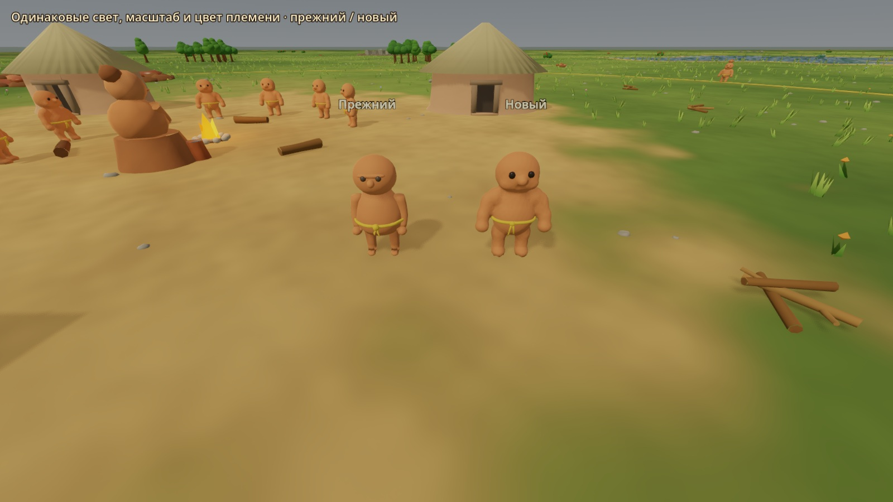
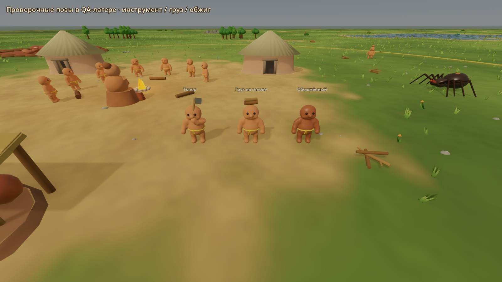

# Новый глиняный житель — 22.10.2026

Задание владельца: Blender → Godot, детская лепка, около 1.75 м, до 5000 треугольников, прежний скелет/пять клипов и контракт поверхностей ClayBody/DarkEyes/GrassCord. Рабочая база dca734c.

План: `art/blender/generate_resident.py` и отдельный помощник геометрии — слитный скульптурный силуэт, веса и воспроизводимый экспорт; `resident.blend`, `resident.glb` — поставочные файлы. Прежнюю модель сохранить в tests/fixtures для сравнения. Добавить структурную проверку модели и GPU-сцену сравнения с настоящим QA-снимком, затем обновить manifest/status.

Риски: сохранность порядка материалов; ориентация +Z лица в Godot; веса в плечах/коленях; отсутствие проникновения подошв при анимации; Socket_Head над макушкой и инструмент в кисти; бюджет геометрии. Серверная симуляция и пользовательские сохранения не меняются. Проверка только в своём QA-каталоге/порту. Художественное одобрение остаётся за владельцем.

## Результат

Новая модель уже заменяет `godot/assets/models/resident.glb` в обычной игре. Генератор геометрии вынесен в `resident_sculpt.py`, прежний rig/IK сохранён и подогнан под новые кисти. Слитная скульптурная форма, более толстые конечности, голова около трети роста, асимметрия, нос и закрытая неглубокая вмятина рта. В idle есть дыхание/поворот головы; правой рукой выполняется удар сверху вниз. Пояс — закрытый шнур, узел и два конца. Три материала, 19 костей, пять циклов по секунде; mesh и узел называются Resident.

Blender 4.2.3 LTS: **2466 вершин, 4908 треугольников**, 0 неманифольдных рёбер, 100% вершин с весами. Godot 4.7.2: высота **1.74596 м**, подошвы Y=0, глаза направлены +Z; контракт материалов/родителей костей проверен на импортированном GLB. Правый инструментальный сокет проходит между двумя фазами удара 0.9208 м. Head socket остаётся на высоте 1.72 + клиентский подъём груза .12.

Файлы: `art/blender/resident.blend`, `generate_resident.py`, `resident_sculpt.py`, `godot/assets/models/resident.glb`, `godot/assets/textures/resident_clay_normal.png`. Изображение normal упаковано в blend/GLB. Прежний GLB dca734c оставлен в `godot/tests/fixtures/resident_before_20261022.glb`; он не загружается обычной игровой сценой. Все модели/фактуры авторские, лицензия проекта.

## Проверки

```powershell
blender --background --python-exit-code 1 --python art/blender/generate_resident.py
godot_console --headless --path godot --editor --import
godot_console --headless --path godot --script tests/world/test_resident_asset.gd
godot_console --headless --path godot --script tests/world/test_resident_work.gd
godot_console --headless --path godot --script tests/world/test_world_dressing.gd
godot_console --headless --path godot --script tests/world/test_network_interpolation.gd
godot_console --headless --path godot --script tests/game/test_kiln.gd
godot_console --headless --path godot --script tests/integration/test_qa_network_client.gd -- --qa-port 8796
npm.cmd run check
```

Все завершились exit0. До сохранения Blender проверяет все вершины по 31 кадру пяти клипов: min Z около 0, опора около 0, подъём подошв .0501/.0505 м для walk/carry_walk. Сохранён прежний шаг .48 м/цикл и политика ускорения клиента. Новый Godot-тест проверяет контракт отдельно от генератора; прежние проверки работы/мира/обжига и 12 сценариев интерполяции прошли.

Integration запускался на **своём** QA-порту 8796 с четырьмя файлами в `tmp/qa/resident-v2/server/`, fixture `tmp/qa/fixtures/fixture_12345.json`. Подтверждены carrying обоих племён, Socket_Head и высота груза, удержание груза после кадров, движение, отключение/подключение без дублей. Сервер остановлен штатно, порт освобождён. Корневой snapshot/genome и сервер игрока не использовались. GPU-снимки — Forward+ Vulkan, RTX4070, 1600×900; это визуальная проверка, не FPS-приёмка 100 жителей.

Для повторения снимков запустить свой QA-сервер и:

```powershell
godot_console --path godot --resolution 1600x900 --script res://tests/visual/capture_resident_remodel.gd -- --server-port 8796 --out F:/GitHub/Clayfolk/docs/godot/screenshots/resident_remodel
```

Скрипт читает настоящий мир без игровых команд. Первые два кадра — обычные сетевые жители. Потом в том же лагере добавлены явно подписанные **проверочные** фигуры старого/нового жителя и три позы; это сравнение моделей, не утверждение, что сервер назначил эти позы. Свет и масштаб для старого/нового одинаковы, цвета племени тоже. Далее четыре ракурса новой фигуры. Финальные JPG визуально проверены.

## Кадры




[Живой лагерь 15 м](screenshots/resident_remodel/resident_live_15m.jpg), [25 м](screenshots/resident_remodel/resident_live_25m.jpg). [Сравнение на 15 м](screenshots/resident_remodel/resident_pair_15m.jpg), [25 м](screenshots/resident_remodel/resident_pair_25m.jpg). [Лицо](screenshots/resident_remodel/resident_front.jpg), [профиль](screenshots/resident_remodel/resident_side.jpg), [сзади](screenshots/resident_remodel/resident_back.jpg), [другой профиль](screenshots/resident_remodel/resident_other_side.jpg).

Работа подготовлена для художественной оценки владельцем. Моргание не добавлено (в idle выбран поворот головы); нет новых костей, одежды или изменений поведения симуляции.
