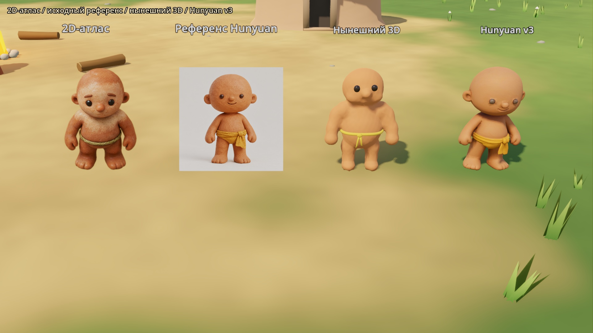
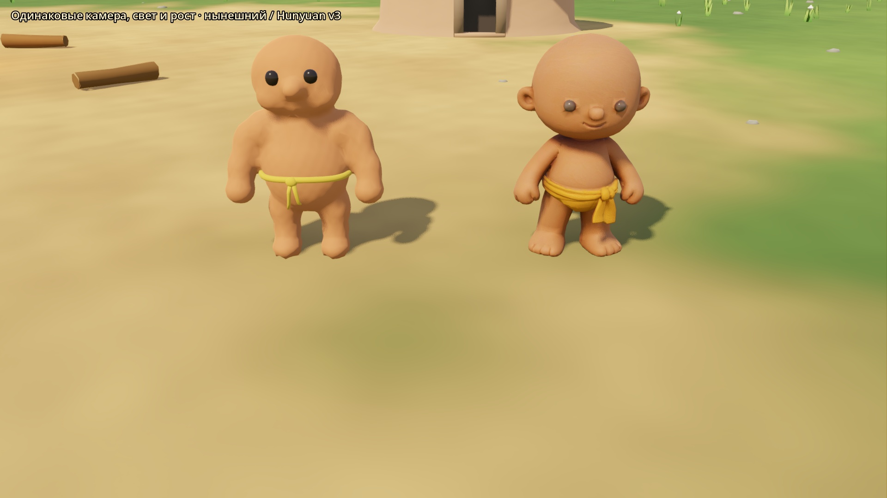
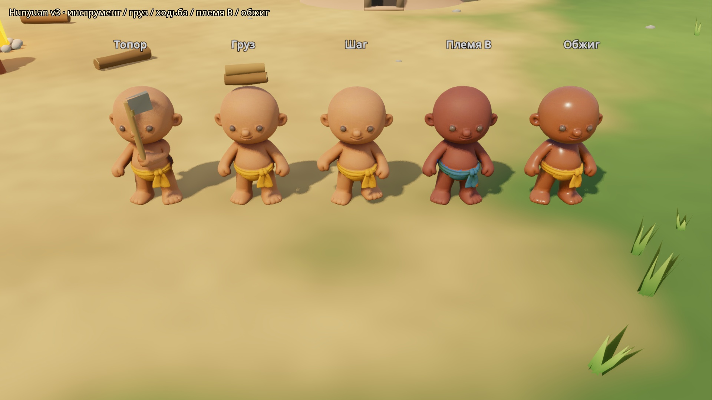
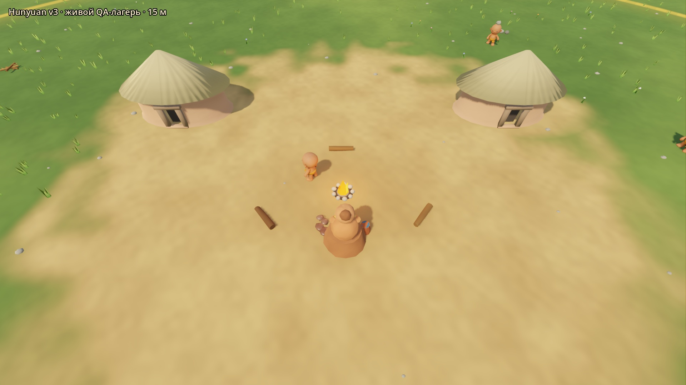
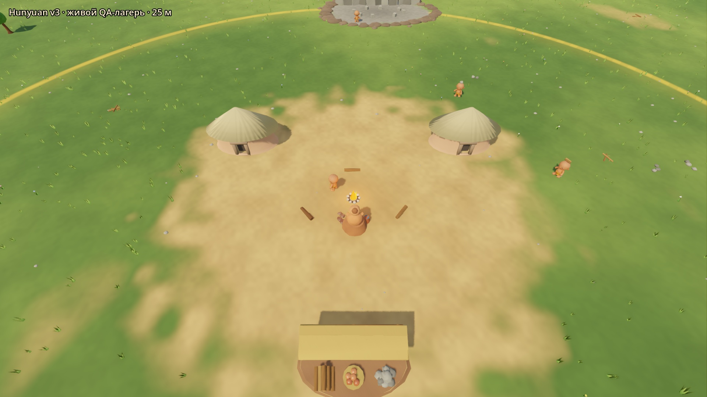

# Житель v3 из Hunyuan 3D

## План и границы

22.10.2026. Исходник — `art/source/resident_hunyuan/resident_hunyuan_lowpoly_textured.glb`. Сохраняем исходную геометрию, UV и нарисованную внешность. Текущий `resident.glb` не заменяем до одобрения владельца.

Файлы этапа:

- `art/blender/prepare_resident_v3.py`, `resident_v3.blend`: воспроизводимые импорт, ориентация, масштаб, разделение материалов, веса, 19 костей и 5 циклов.
- `godot/assets/models/resident_v3.glb`, текстуры в `godot/assets/textures/resident_v3/`.
- `network_resident.gd`: только явный выбор QA-варианта и его перекраска; обычный запуск сохраняет прежнюю модель.
- Отдельная проверка ассета, сравнительные кадры и замер на изолированном QA-сервере; манифест и статус миграции.

Риски: слитая сетка у плеч и повязки требует корректировки весов; цветная текстура темнеет при обычном умножении; больший полигональный бюджет нужно проверить на 90 жителях. Пользовательские сохранения и серверную игровую логику не меняем.

## Происхождение и условия

Проверено 22.10.2026: ссылка из подвала сайта `3d.hunyuan.tencent.com` ведёт на [腾讯混元3D用户服务协议](https://rule.tencent.com/rule/202501080004), редакция 26.05.2025. Пункт 5.3 оставляет права на загруженное и сгенерированное содержимое пользователю либо законному правообладателю. В этой редакции нет запрета коммерческого использования результатов. Это условия сайта генерации, не лицензия открытых весов Hunyuan.

При распространении нужно явно обозначать AI-происхождение (§3.3), сохранять имеющиеся обозначения и сведения о правах (§3.6(1), §5.6). §1.1 ограничивает доступ к самому сервису пользователями материкового Китая; это не разрешение создавать новые аккаунты или обходить ограничения. Здесь обрабатывается уже переданный владельцем файл. Исходные изображения и модель предоставлены владельцем; их происхождение зафиксировано в README исходника. В производном GLB сохраняем указание Tencent Hunyuan 3D и AI-происхождение в metadata.

## Результаты

Подготовлен отдельный **QA-кандидат**, нынешний житель не заменён. Исходная Hunyuan-модель сохранена в `art/source/` без изменений; лицо, уши, пальцы, узел и внешняя текстура не перерисованы.

| Параметр | Результат |
|---|---|
| Blender / Godot | 4.2.3 LTS / 4.7.2 stable, Forward+ |
| Источник | 7744 треугольника, 4683 импортные вершины, GLB 29 967 444 байта |
| Подготовленный меш | **7674 треугольника**, 3827 Blender-вершин после сварки UV-дубликатов |
| Рост / ориентация | **1.750 м**, подошвы Z=0, Blender −Y / Godot +Z |
| Контракт | `Resident`, поверхности `ClayBody` / `DarkEyes` / `GrassCord`, `ResidentArmature`, 19 костей с прежней иерархией |
| Текстуры | albedo, normal, roughness по 2048²; metallic=0; упакованы в blend/GLB |
| Экспорт | `godot/assets/models/resident_v3.glb`, около 9.5 MB / 9.1 MiB |
| Выбор в клиенте | `--resident-v3`; без флага загружается прежний `resident.glb` |

### Чистка и риг

Удалены дубли вершин на UV-швах с сохранением UV по углам полигонов. У исходной реконструкции были лишние пересекающиеся грани у контактов пальцев и мелкие дырки у внешних краёв ступней: выполнена локальная чистка и закрытие этих границ. Отдельно разомкнут слипшийся участок **за правой рукой у талии**, обе полученные границы закрыты. Массового remesh/decimate или скульптинга нет. Контрольная проверка требует **0 неманифольдных рёбер** и сохранения исходных координат головы и пальцев; новые вершины относятся к локальным закрытиям. Исходный GLB остаётся нетронутым.

После автоматической привязки веса заданы и сглажены по анатомическим областям и связности сетки. Кисти/пальцы отделены от повязки по компонентам сетки, голова сохраняет жёсткую форму; плечи, шея и бёдра смешивают соседние кости. Не более четырёх влияний на вершину. Это тот же **контракт имён**, но rest-позиции подогнаны под Hunyuan: Hips Z=.48, Spine Z=.66, Head Z=1.01; плечи ±.28/Z=.91, локти ±.40/Z=.72, кисти ±.44/Z=.53. `Socket_Head` на Z=1.75; `Socket_Tool_R`=(.45,−.09,.49), `Socket_Cargo`=(0,−.44,.85).

Все пять клипов зациклены, 1 с / 30 FPS. `walk` и `carry_walk` сохраняют шаг .48 м за цикл и IK-опору; для широких ступней уменьшен наклон носка. `carry_*` используют спокойные руки: груз по текущему клиентскому контракту находится на голове. `work_gather` — правый замах перед корпусом, уменьшенный наклон туловища; инструмент не проходит через большую голову. Ход сокета правой руки **0.663 м**. Проверка 31 кадра каждого клипа: шов цикла 0, проникновения подошв нет, погрешность опоры <0.001 мм, подъём подошв в махе **51.6 мм**. Числа и диагностический максимум растяжения рёбер записаны в `art/blender/resident_v3_validation.json`.

### Текстуры и перекраска

Внешняя текстура исходника уже окрашена в глину и охру. Для v3 `albedo_color` вычисляется **относительно палитры A**, поэтому A получает множитель (1,1,1), а B/обжиг — отношение целевого цвета к A. Обычный житель использует прежнюю формулу. Это сохраняет детали и исходный цвет A; синяя повязка B читается без грязного умножения охры на синий. Обожжённый темнее и имеет roughness=.42. Поверхности по-прежнему `StandardMaterial3D`, исходные Blender-материалы — Principled BSDF.

Настройки `.png.import` закрепляют VRAM-сжатие и mipmaps, normal-карта помечена как normal. PNG, извлечённые Godot из GLB, повторно не коммитятся; их настройки импорта коммитятся. Экземпляры делят меш и текстуры — это отдельно проверяет тест ассета.

**Оставшаяся визуальная особенность:** в предельном замахе справа у повязки заметен тёмный текстурный переход в области исходного контакта руки с талией ([крупный боковой кадр](screenshots/resident_v3/strike_side.jpg)). Сетка там замкнута; для более ровного цвета потребуется локальная ретушь/bake текстуры. Эту область не закрашивал, поскольку задача запрещает перерисовывать внешность. На основной игровой камере 15–25 м этот переход малозаметен. Художественное одобрение владельцем ещё не получено.

## Сравнение

Две 3D-модели сняты одной камерой, при одинаковых свете, росте и племени. Первые два элемента — неизменённые плоские эталоны (референс со своим исходным фоном); на них не распространяется освещение 3D-мешей.











Крупные ракурсы: [спереди](screenshots/resident_v3/front.jpg), [слева](screenshots/resident_v3/left.jpg), [справа](screenshots/resident_v3/right.jpg), [сзади](screenshots/resident_v3/back.jpg), [шаг сбоку](screenshots/resident_v3/walk_side.jpg). Замах: [0](screenshots/resident_v3/strike_0.jpg), [0.25](screenshots/resident_v3/strike_25.jpg), [0.5](screenshots/resident_v3/strike_50.jpg), [0.75](screenshots/resident_v3/strike_75.jpg), [сбоку](screenshots/resident_v3/strike_side.jpg).

## Проверки

Blender-сборка и Godot import завершились с кодом 0. Следующие проверки завершились с кодом 0 **в обоих режимах**, без флага и с `--resident-v3`:

- `godot/tests/world/test_resident_asset.gd`: материалы/текстуры, рост, бюджет, 19 костей/родители, сокеты, пять циклов, удар; для v3 также общий ресурс меша/текстур и явный доступ к текущей модели в том же процессе.
- `godot/tests/world/test_resident_work.gd`.
- `godot/tests/world/test_world_dressing.gd`.
- `godot/tests/game/test_kiln.gd`.

`godot/tests/integration/test_qa_network_client.gd -- --qa-port 8811 --resident-v3`: **ALL PASSED**, оба племени по 8 жителей, по одному носильщику в каждом, `Socket_Head` и груз выше головы, движение/направление, disconnect/reconnect без дублей, чистое удаление узлов. Проверялся fixture tick=12345 на своём сервере.

QA запускался через `scripts/godot/qa_server.py --reset --state-dir tmp/qa/resident_v3_review --port 8811`. Для снимков — свежий мир, для интеграции — отдельная загрузка QA-fixture. Замер использует `tmp/qa/resident_v3_perf`, порт 8812 и отдельный fixture на 45 жителей в каждом племени. Четыре пути файлов состояния задаёт QA-runner; пользовательские сохранения не использовались. Каждый свой сервер остановлен через stop-файл с освобождением порта.

## Производительность

Одинаковый живой QA-fixture, 90 жителей в начале / 84 в конце каждого 20-секундного прогона; RTX 4070, 1920×1080, Forward+, 1×. `probe_hitches.gd` сбрасывает фоновый лимит 20 FPS **только во время измерения**, чтобы переключение окон не исказило результат. Измерение учитывает весь клиент с окружением и серверными пакетами, а не только меш.

| Модель | Средний кадр | p50 | p95 | p99 | Максимум | Кадров >25 мс |
|---|---:|---:|---:|---:|---:|---:|
| Нынешняя | 10.12 мс | 10.01 | 13.37 | 19.26 | 45.09 | 9 |
| Hunyuan v3 | 10.13 мс | 10.00 | 13.82 | 19.21 | 44.00 | 10 |

Средний кадр практически одинаковый, около 99 FPS на этом стенде. У v3 p95 выше на 0.45 мс; p99 и максимум немного ниже. Короткий прогон не доказывает равенство во всех сценах и на другом GPU. Видеопамять всего клиента: 467 781 664 → 509 048 112 байт (**+39.4 MiB**), включая более крупный skinned mesh и текстуры. Общие меш/текстуры не размножаются на каждого жителя. [Лог нынешней модели](qa/resident_v3/probe_current.txt), [лог v3](qa/resident_v3/probe_v3.txt), [сетевой тест v3](qa/resident_v3/integration.txt).

## Воспроизведение

Из корня репозитория:

```powershell
blender --background --python-exit-code 1 --python art/blender/prepare_resident_v3.py
godot_console --headless --editor --path godot --import
godot_console --headless --path godot --script tests/world/test_resident_asset.gd -- --resident-v3
```

Для собственного свежего QA-сервера (свободный порт и отдельный каталог обязательны):

```powershell
py -B scripts/godot/qa_server.py --reset --port 8811 --state-dir tmp/qa/resident-v3-manual
```

Во втором терминале:

```powershell
godot_console --path godot --script tests/visual/capture_resident_v3.gd -- --qa-port 8811 --resident-v3
godot_console --path godot --script tests/visual/probe_hitches.gd -- --qa-port 8811 --seconds 20 --speed 1 --resident-v3
```

Обычный запуск клиента с `--resident-v3` также показывает кандидата. `NetworkResident.new(0)` принудительно выбирает нынешнюю модель, `new(1)` — кандидата: сравнение не зависит от глобального флага. Существующий игровой запуск и `resident.glb` остаются прежними до одобрения владельцем.
