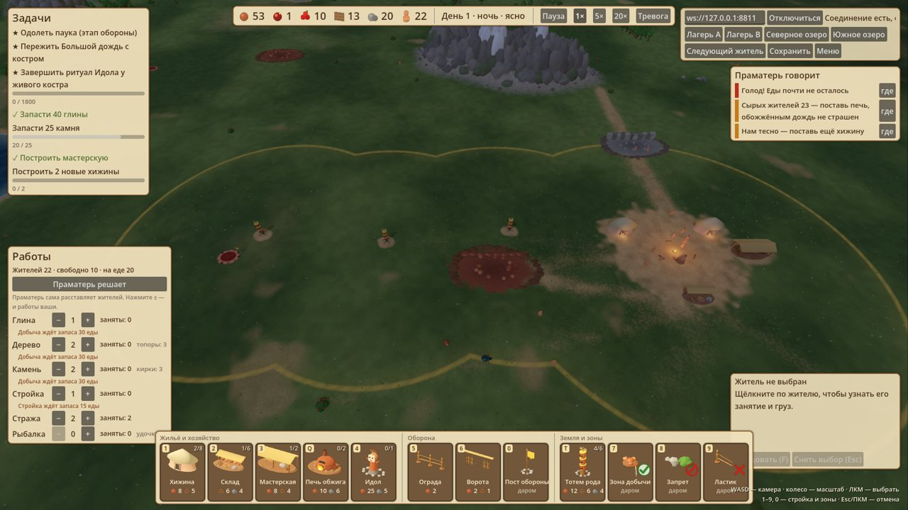
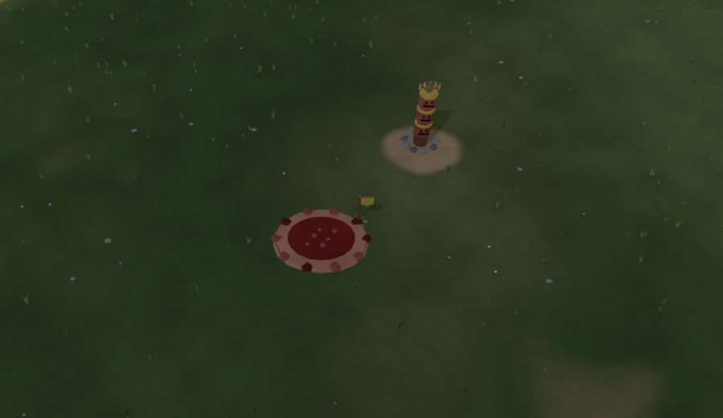

# Территория, тотемы и источники особой глины — этап 3

Концепция: [Праматерь и смысл партии](../Праматерь%20и%20смысл%20партии.md).

## Что сделано

**Земля племени** (`shared/territory.ts`, одинаково на сервере, в 2D-клиенте и в `godot/scripts/game/build_rules.gd`):
- Земля — это круг радиусом 45 вокруг костра и круг радиусом 36 вокруг каждого достроенного тотема.
- Строить здания, стены и ворота можно только на своей земле. Иначе отказ «Вне своей земли — поставь тотем ближе» или «Чужая земля».
- Где круги племён перекрываются, земля достаётся тому, чей центр «глубже».
- Мир без лагерей (тестовые стенды) правил земли не имеет.

**Тотем рода**: 12 глины, 6 дерева, 4 камня, до 6 на племя. Ставится на своей земле и после постройки раздвигает её.

**Источники особой глины** (`server/src/sim/springs.ts`):
- На карте 3 источника: по одному «своему» в 85–115 от каждого лагеря (зеркально через центр карты, чтобы было честно) и спорный у центра.
- Ставятся отдельным генератором после принятия карты, поэтому сама карта для тех же сеедов не меняется.
- Источником владеет племя, на чьей земле он лежит. Владелец получает единицу особой глины раз в 300 тиков.
- Смена владельца попадает в журнал: «Племя B заняло источник особой глины».
- Строить вплотную к источнику нельзя.

**Ритуал Идола питается особой глиной**: единица на каждые 60 тиков прогресса, всего 30. В плейтесте идол был готов ко второму дню, теперь сначала нужно занять источник. В старых сохранениях без источников ритуал прежний.

**ИИ-сосед** ставит тотемы цепочкой от края своей земли к ближайшему ничейному источнику.

**Советы и задачи**:
- советы «Рядом ничей источник — поставь тотем в его сторону» и «Соседи держат источник — ритуалу нужна особая глина»;
- задачи «Поставить тотем рода» и «Занять источник особой глины».

**Godot-клиент**:
- граница земли нарисована на траве шейдером: пунктир цвета племени (охра у A, синий у B) и лёгкий оттенок у края;
- тотем — столб с тремя масками и лентами цвета племени;
- источник — блестящая красная глиняная лужа с пузырями; у занятого стоит флажок владельца;
- подсказка «Источник особой глины · ничей / у племени B»;
- плитка «Тотем» (клавиша T) в группе «Земля и зоны»;
- особая глина в верхней панели.

Панель построек сужена под 12 плиток (короткие подписи, полные названия в подсказке). Инспектор поднят над ней.

**2D-клиент** рисует тотем столбом с масками. Источники и границу земли он не рисует.

## Проверка

- `npm run check:territory` — 23 проверки:
  - источники на 6 картах: далеко от лагерей, детерминированы, честно расставлены, у каждого лагеря свой в пределах 115;
  - правила земли для зданий и оград;
  - тотем раздвигает землю только после постройки;
  - владение и доход источника, потеря его вместе с тотемом, сохранение;
  - 24 000 тиков живой симуляции: ИИ-сосед поставил 3 тотема и занял источник (расстояние 90 → 12).
- Ритуал без особой глины не стартует, с 30 единицами завершается (`check:gameplay`).
- Паритет размещения пересобран: 1200 запросов, 0 расхождений по всем причинам, включая «Чужая земля», «Вне своей земли» и «источник».
- `godot/tests/game/test_territory.gd` — 18 проверок клиента. Все остальные серверные и Godot-тесты зелёные, включая интеграционные.
- Живая проверка на изолированном QA-сервере, новая случайная карта (`godot/tests/visual/capture_territory.gd`):
  - игрок настоящим инструментом поставил мастерскую и цепочку тотемов к своему источнику (107 от лагеря);
  - племя заняло источник, и пошла особая глина.

## Ограничения

- Отнять источник у соседа сейчас можно только, если его тотем разрушат враги. Осада тотемов и победа по источникам — этап 4.
- Улучшения хижин вместо предела в 8 пока нет.
